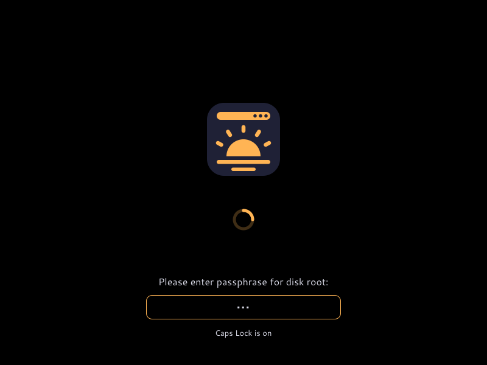

# Configuration and themes

The only configuration file is the theme: `/etc/lys-splash/theme.yaml`, or the
file `--theme` names. Without it the embedded theme applies; a field left out
keeps the embedded value.

| Field | Values | Default | Effect |
| --- | --- | --- | --- |
| `background` | `#rrggbb` | `#000000` | Background colour |
| `foreground` | `#rrggbb` | `#d8d9e6` | Message and prompt text |
| `accent` | `#rrggbb` | `#ffb454` | Throbber, progress bars, prompt border |
| `logo` | `firmware`, `lys` | `firmware` | `firmware`: the firmware's logo (ACPI BGRT) if it left one on screen, else lys's. `lys`: always lys's |
| `throbber` | `spinner`, `dots` | `spinner` | Busy animation |
| `units` | bool | `false` | Shows the name of each unit systemd starts under the throbber |
| `prompt-hints` | bool | `true` | Shows "Caps Lock is on" under a prompt and the console keymap beside it |

The default background is black so the firmware's logo, drawn on black, blends
in. The logo image, the font and the scale are not configurable.

```yaml
accent: "#7aa2f7"
throbber: dots
units: true
```

`prompt-hints`:



`throbber: dots`:


## Applying it

| System | How |
| --- | --- |
| NixOS | Set `boot.lys-splash.theme` (same fields); the module writes the file into the initrd and the system |
| Ubuntu, Debian | Edit `/etc/lys-splash/theme.yaml`, then `sudo update-initramfs -u` so the hook copies it into the image |
| Running splash | `lys-splash reload` re-reads the file |

```nix
{
  boot.lys-splash.theme = {
    accent = "#7aa2f7";
    throbber = "dots";
  };
}
```

## Invalid themes

A theme with an unknown field, a colour that is not `#rrggbb` or a value outside
its list is rejected whole: the splash logs a warning naming the file, line and
field, and draws the embedded theme. The NixOS option is not validated at build
time. See [where the logs are](/guide/install#check-that-it-works).
