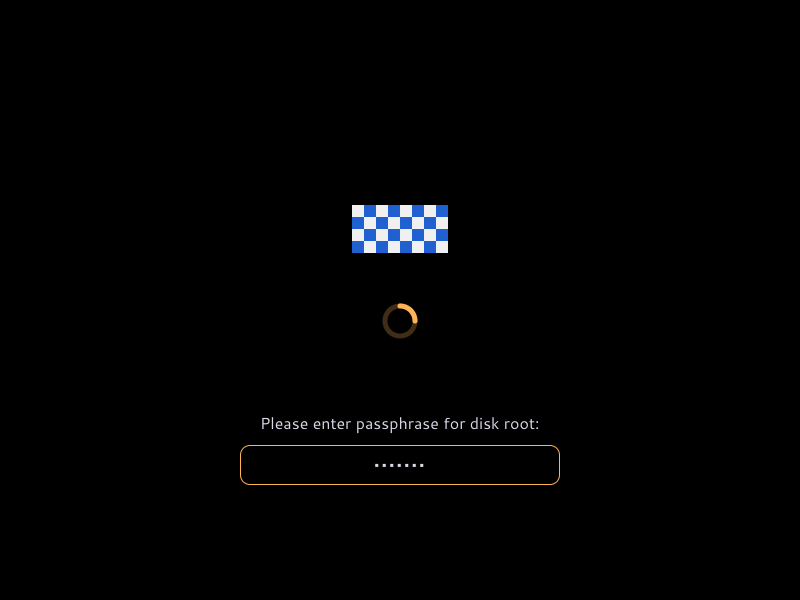

# Getting started

lys-splash is the lys desktop's boot splash and replaces Plymouth; the two do
not run side by side. It shows from the initrd until the display manager or the
login prompt takes over, asks for disk passwords, and shows again on shutdown,
reboot and kexec.

## What you see

- **Logo:** the firmware's own logo if it left one on screen, otherwise lys's.
- **Throbber:** a spinner, or three dots (see the [theme](/guide/configuration)).
- **Progress bar:** this boot's elapsed time against the previous boot's
  duration. It stays short of full until the splash quits. Without a recorded
  previous boot there is no bar.
- **Password prompt** when a disk needs one:

Shutdown, reboot and kexec show the logo and throbber until the power goes.

## Keys

| Key | Action |
| --- | --- |
| <kbd>Esc</kbd> | Toggles the boot messages |
| <kbd>Enter</kbd> | Answers the prompt |
| <kbd>Backspace</kbd> | Deletes the last character |
| <kbd>Ctrl</kbd>+<kbd>C</kbd>, <kbd>Ctrl</kbd>+<kbd>D</kbd> | Abandons the prompt |

Keys are read from the active virtual terminal and follow the console keymap.

## Next

1. [Install](/guide/install) it.
2. Reboot. To boot once without it, add `plymouth.enable=0` to the kernel
   command line.
3. Adjust colours, logo or throbber in [`theme.yaml`](/guide/configuration).

::: warning Not on a running desktop
The daemon takes DRM master on every card and the active virtual terminal.
Starting it by hand takes the display from your session. Try it in a VM.
:::
