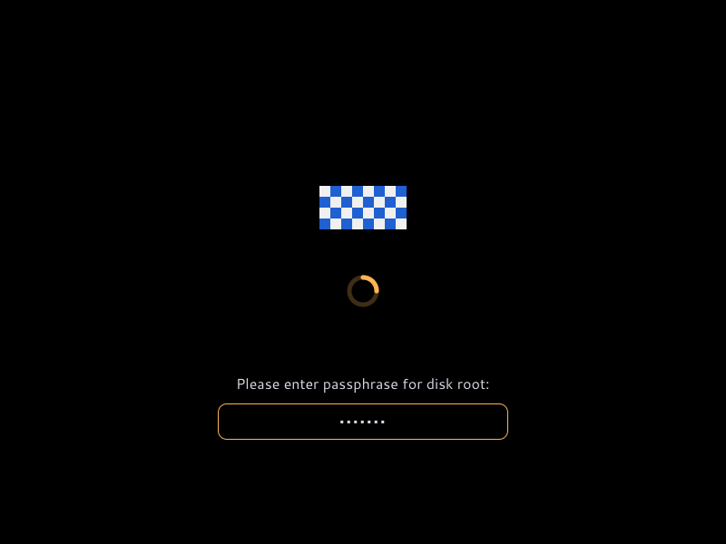

# Getting started

lys-splash is the lys desktop's boot splash. It takes Plymouth's place: it
shows a logo and a throbber from the initrd until the display manager or the
login prompt takes over, asks for disk passwords on the way, and shows a splash
again on shutdown and reboot.

It speaks plymouthd's socket protocol and answers to plymouth's command line,
so systemd, its password agents and scripts that call `plymouth` work without
changes. It replaces Plymouth; the two do not run side by side.

## What you see

- **The logo.** The firmware's own logo when it left one on screen, otherwise
  lys's.
- **A throbber.** A spinner, or three dots if the
  [theme](/guide/configuration) asks for them.
- **A progress bar under it**, from the second boot on. It compares this boot's
  time with how long the previous one took, and stays short of full until the
  splash quits. The first boot has nothing to compare with and shows no bar.
- **A password prompt** when a disk needs one. A test pattern stands in for the
  firmware's logo in this picture:

Shutdown, reboot and kexec show the same logo and throbber, until the power
goes.

## Keys

| Key | What it does |
| --- | --- |
| <kbd>Esc</kbd> | Shows the boot messages, and the splash again |
| <kbd>Enter</kbd> | Answers the prompt |
| <kbd>Backspace</kbd> | Deletes the last character typed |
| <kbd>Ctrl</kbd>+<kbd>C</kbd>, <kbd>Ctrl</kbd>+<kbd>D</kbd> | Abandons the prompt |

Keys are read from the virtual terminal, so they follow the console's keymap.

## Next

1. [Install](/guide/install) it on NixOS, or on Ubuntu or Debian.
2. Reboot. To boot once without it, add `plymouth.enable=0` to the end of the
   kernel command line.
3. Change its colours, logo or throbber in
   [`theme.yaml`](/guide/configuration).

::: warning Not on a running desktop
The splash takes DRM master on every card and the active virtual terminal.
Starting the daemon by hand on a machine you are using takes the display away
from your session. Try it in a VM.
:::
